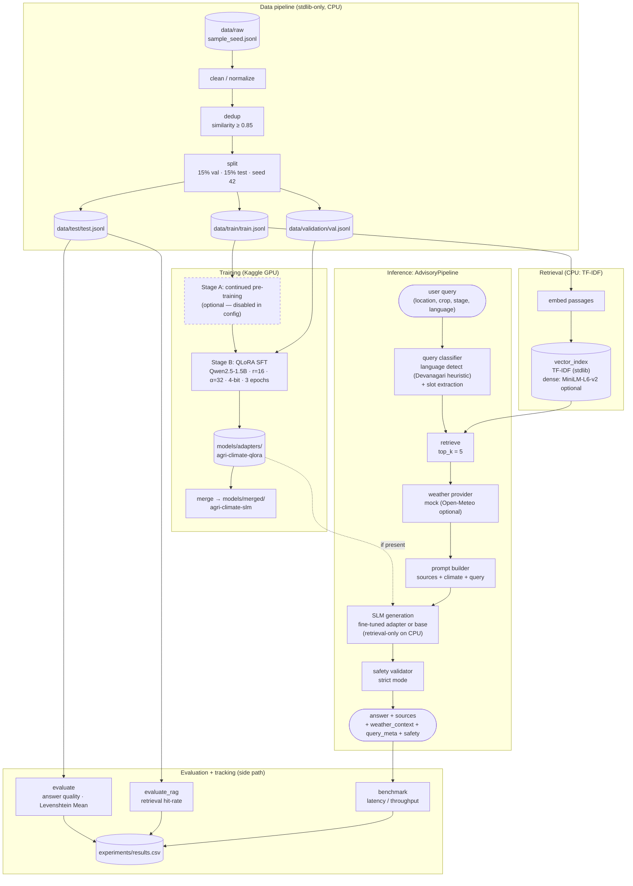

# Architecture

End-to-end system diagram for `agriculture-climate-slm`. All parameters live in
`config.yaml` (single source of truth); the boxes below are the `src/` modules that
read from it.

## Component notes

| Component | Module | Runs on |
|---|---|---|
| Config loader | `src/data/config_loader.py` | CPU (stdlib) |
| Data pipeline | `src/data/prepare.py` | CPU (stdlib) |
| QLoRA SFT | `src/training/train.py` | Kaggle GPU (T4+) |
| TF-IDF index / retriever | `src/retrieval/` | CPU (stdlib); dense embeddings optional |
| Weather provider | `src/climate/` | CPU (`mock`; Open-Meteo toggle in config) |
| Advisory pipeline | `src/inference/pipeline.py` | CPU retrieval-only; GPU for generation |
| Safety validator | `src/safety/` | CPU |
| Evaluation | `src/evaluation/` | CPU (pure-Python metric fallbacks) |
| Baseline runner | `experiments/run_baselines.py` | CPU |

## Key design decisions

- **Config-driven**: every hyper-parameter, path, and toggle is read from `config.yaml`.
  No hard-coded training or retrieval parameters in `src/`.
- **Two-stage training, one enabled**: Stage A (continued pre-training) is optional and
  disabled (`stage_a_enabled: false`); Stage B (QLoRA SFT) is the training path.
- **Retrieval-first inference**: the pipeline always grounds answers in retrieved
  passages and explicit weather context; the SLM generates on top, and the safety
  validator (`safety_strict: true`) gates the final answer.
- **Multilingual by detection**: Hindi is detected with a Devanagari heuristic;
  technical agronomy terms are preserved, not blindly translated.
